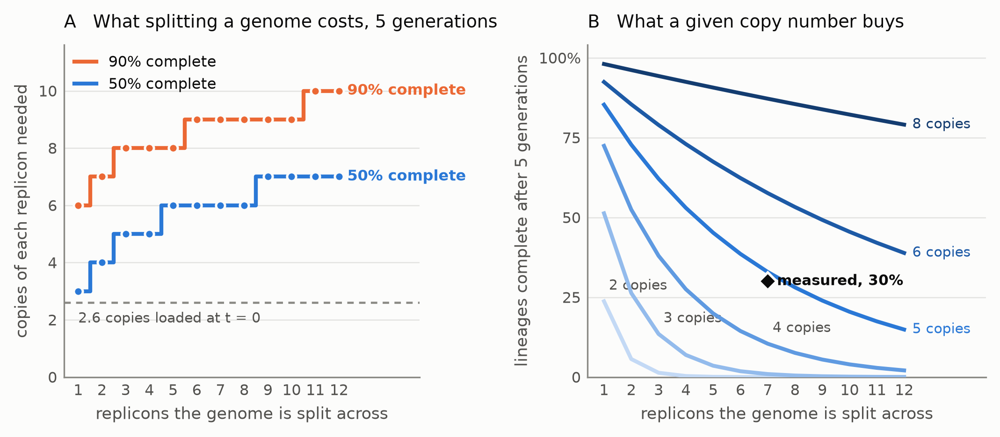
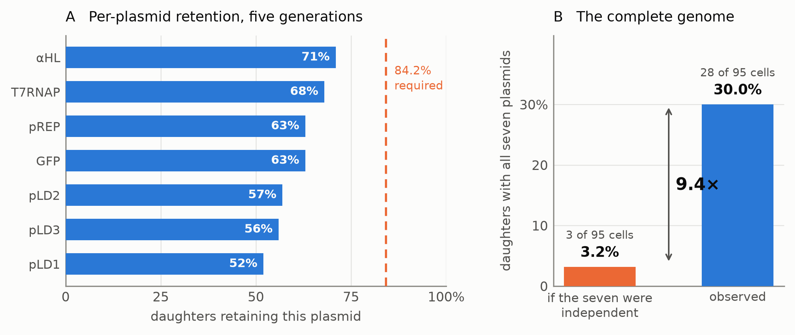

# The inheritance cost of splitting a synthetic genome across replicons

*Methods, Results and Limitations are generated from `results/` by `scripts/build_manuscript.py`; do not edit numbers here. Abstract, Introduction and Discussion are in `paper/sections/` and are the author's to write.*

Independent researcher, Beaumont, TX

## Abstract

<!-- DRAFT -->
A synthetic cell that divides without segregation machinery distributes its
contents to its daughters by chance. For one plasmid in many copies this is
well understood. A genome split across several *distinct*
replicons is not, because every replicon must be inherited at once and
the chance of a complete set is the product of the individual chances. We
give the design rule that follows. For a lineage to still hold a complete
genome after five generations of random partitioning, three copies of each
replicon suffice when the genome sits on one, and seven when it is split
across twelve; a 90% target runs from six copies to ten. Splitting a genome
is therefore severe in completeness and mild in copy number, and the two
readings are easily confused. We then apply the rule to the one built system
that reports what it needs. Gaut et al. (2026) report seven
plasmids, the per-plasmid retention after five generations, and 30% of
daughters complete. Independent partitioning of the measured rates predicts
**3.2%**, a factor of **9.4** below the observation, and the rule reads that
observation as about five copies of each plasmid against 2.6 loaded.
Copy number at division would settle it.

## 1. Introduction

<!-- DRAFT -->
A cell that divides must give each daughter a complete copy of its genome.
Bacteria achieve this with dedicated machinery. By contrast, synthetic cells assembled from
purified components generally have none, and must rely on the contents of the
parent being distributed by chance. How well that works sets a ceiling on how
many generations such a system can run.

For a single plasmid present in many copies, the answer is classical and
reassuring. If each copy independently enters one daughter or the other with
equal probability, a daughter receives none of them with probability
2^(1−n) in the mother's copy number n, so loss falls exponentially as copy
number rises. This is why reviews of synthetic cell division observe that
random partitioning suffices provided the cargo consists of a large number of
relatively small, identical molecules (Olivi et al., 2021).

A multipartite genome breaks that assumption in a way that has not, to our
knowledge, been analysed. When the genome is divided across several
*distinct* plasmids, a daughter is viable only if it receives at least one
copy of **every** type. If the types partition independently, the probability
of a complete set is the product of the individual retention probabilities,
and a product of numbers below one falls quickly in the number of terms. The
design decision that makes a synthetic genome easier to assemble and modify
therefore carries an inheritance cost, and the size of that cost has not been
quantified.

We searched for prior treatments of joint retention across multiple distinct
replicons and found none. The literature on plasmid segregation is extensive
but concerns copy number of a single type; natural multipartite genomes, such
as that of *Vibrio cholerae*, maintain their replicons with active
segregation systems rather than by chance.

We quantify it here. From a closed form with no fitted parameters we give the
per-replicon copy number a genome needs in order to stay complete through a
chosen number of generations, as a function of how many replicons it has been
divided into. The answer is more encouraging than the product rule suggests at
a glance, because copy number enters the expression at the point where it does
the most work.

We then test that rule against the only built system reporting the
measurements it requires. Gaut et al. (2026) report a synthetic cell whose
90 kbp genome is carried on seven plasmids, which feeds, grows, replicates its
DNA and divides, and which sustains five generations with 30% of daughters
retaining the complete genome despite having no segregation machinery. They
also report the per-plasmid retention rates. Those two measurements are
sufficient, on their own, to test whether the plasmids are inherited
independently, a test the paper does not perform. We perform it here, and read
the result back through the design rule.

## 2. Methods

### 2.1 Source of every parameter

All values are taken from Gaut NJ, Deich C, Cash B, Hoog T, Engelhart AE, Adamala KP. *A Chemically Defined Synthetic Cell Capable Of Growth And Replication.* bioRxiv 2026.07.01.735724 (2026). doi:10.64898/2026.07.01.735724 and each is cited to the figure, table or methods section it came from in `docs/PARAMETERS.md`. No parameter is estimated, fitted or assumed. Two are used here:

| Quantity | Value | Source |
|---|---|---|
| Daughters retaining aHL | 71.0% | Fig. 3p |
| Daughters retaining T7RNAP | 68.0% | Fig. 3p |
| Daughters retaining GFP | 63.0% | Fig. 3p |
| Daughters retaining pREP | 63.0% | Fig. 3p |
| Daughters retaining pLD2 | 57.0% | Fig. 3p |
| Daughters retaining pLD3 | 56.0% | Fig. 3p |
| Daughters retaining pLD1 | 52.0% | Fig. 3p |
| Daughters retaining **all seven** | **30.0%** | Fig. 3o |
| Single cells analysed | 95 | Methods 23 |
| Generations | 5 | Fig. 3; Methods 11 |

Retention for &alpha;HL is stated numerically in SI section 6; the remaining six are read from the bar chart in Fig. 3p and carry approximately &plusmn;3 percentage points.

### 2.2 The independence prediction

If each plasmid reaches a given daughter independently of the others, the probability that daughter receives all seven is the product of the seven individual retention rates. This requires no model of division, no simulation and no free parameter; it is a consequence of the measurements themselves. The comparison is therefore a test of the independence assumption alone.

### 2.3 Significance

The 95 single cells are each complete or not, so the counts carry the test: a one-sided exact binomial test of the observed number of complete cells against the rate independence predicts. The interval on the observed rate is reported two-sided. One-sided is appropriate because the question is whether fidelity *exceeds* chance.

### 2.4 The copy-number alternative

A cell carrying *c* copies of each plasmid at division misses a given plasmid only if all *c* copies go to the other daughter. Writing *p* for the probability a copy reaches this daughter, the chance of a complete set is (1 - (1 - p)^c)^7. This is implemented in `src/inheritance.py` and is exercised by 21 unit tests. It matters here because &Phi;29 replicates continuously with no checkpoint, so copy number at division is not the 2.6 copies loaded at t = 0.

### 2.5 The general design rule

The same expression answers the design question directly. A lineage stays complete through *G* successive divisions only if it is complete at every one of them, so for a genome on *N* replicons at *c* copies each the probability is (1 - (1 - p)^c)^(NG). Inverting it for *c* gives the smallest copy number that reaches a chosen completeness after *G* generations. We evaluate this for *N* = 1 to 12 replicons at *G* = 5, the number of generations the source reports, and at two completeness targets. The calculation is in `scripts/design_rule.py` and uses the same closed form as §2.4; nothing is fitted.

## 3. Results

### 3.1 The inheritance cost of splitting a genome

**Figure 1. Splitting a genome across replicons is affordable, but only if copy number rises with it.** (**A**) The smallest per-replicon copy number at which a lineage still holds a complete set after 5 generations of random partitioning, against the number of replicons the genome is divided into, at two completeness targets. (**B**) The same model read as the completeness a given copy number buys. The measured point is the published system, 7 replicons at 30% complete after 5 generations, which implies about 5 copies of each replicon against the 2.6 loaded at t = 0. No parameter is fitted; both panels are the closed form of §2.5.

| Replicons | Copies for 50% complete | Copies for 90% complete | Complete at 5 copies |
|---|---|---|---|
| 1 | 3 | 6 | 85.3% |
| 2 | 4 | 7 | 72.8% |
| 3 | 5 | 8 | 62.1% |
| 5 | 6 | 8 | 45.2% |
| 7 | 6 | 9 | 32.9% |
| 10 | 7 | 9 | 20.4% |
| 12 | 7 | 10 | 14.9% |

The second and third columns are the result a group designing a synthetic genome can act on. Holding a complete set in half of all lineages after 5 generations takes 3 copies when the genome sits on one replicon and 7 when it is split across 12; the 90% target runs from 6 to 10 over the same range.

**The cost of splitting is severe in completeness and mild in copy number, and the two readings are easy to confuse.** At a fixed 5 copies, going from one replicon to 12 drops completeness from 85.3% to 14.9%, a factor of 5.7, which reads as prohibitive. Expressed as the copies an experimenter would have to engineer, the same change costs 4 extra copies. The first number is what the product rule does to a fixed design; the second is what it costs to repair one, and only the second is a design decision. A multipartite synthetic genome is therefore not an inheritance problem so much as a copy-number requirement, and a modest one.

The requirement grows slowly because copy number enters as (1 - 2^-c) per replicon while replicon count enters as an exponent: each added copy halves the chance of losing a given replicon, so roughly log2 N extra copies absorb a genome split N ways. This is the useful general statement, and §3.2 tests it against a system that was actually built.

### 3.2 A published system sits above the independent prediction

**Figure 2. Measured genome fidelity exceeds independent partitioning by 9.4×.** (**A**) Per-plasmid retention after 5 generations, from Fig. 3p of the source. The dashed line marks 84.2%, the rate every plasmid would need for independent partitioning to account for the observed complete-genome fraction; no plasmid reaches it. (**B**) The product of the seven rates, 3.2%, against the measured 30.0% (Fig. 3o). Of 95 single cells, independence predicts 3 complete genomes and 28 were observed. No parameter is fitted: panel B is the product of panel A.

| | |
|---|---|
| Mean per-plasmid retention | 61.4% |
| **P(all seven) if independent** | **3.2%** |
| **P(all seven) measured** | **30.0%** |
| Ratio | **9.4×** |
| Complete cells of 95: predicted / observed | 3.0 / 28 |
| Binomial test | **p = 1.36e-19** |
| Observed rate (95% CI) | 29.5% (20.6%–39.7%) |
| Retention needed for independence to hold | 84.2% |

For independence to be consistent with the measured 30.0%, every one of the seven plasmids would have to be retained at 84.2% — against a measured mean of 61.4% and a measured maximum of 71.0%. No reading of Fig. 3p supports that.

This also tests a claim the source makes but does not quantify: that dividing the genome across seven plasmids *"limits the possible influence of stochastic inequalities in plasmid partitioning"* (SI section 7). For inheriting a **complete set**, independent partitioning implies the opposite — each additional plasmid multiplies in a further chance to fail. The 3.2% figure is that argument stated numerically.

### 3.3 Copy number alone can account for the gap

Independent partitioning of *c* copies per plasmid gives:

| Copies at division | One division | After 5 generations |
|---|---|---|
| 1 | 0.0078 | 0.0000 |
| 2 | 0.1335 | 0.0000 |
| 3 | 0.3927 | 0.0093 |
| 4 | 0.6365 | 0.1045 |
| 5 | 0.8007 | 0.3292 |

Surviving 5 independent divisions at 30.0% overall requires 78.6% per division, which independent partitioning reaches at **5 copies** per plasmid — against 2.6 loaded at t = 0.

**So the ninefold gap does not by itself demonstrate correlated partitioning.** Continuous replication to roughly twice the loaded copy number would produce the same observation with partitioning that is perfectly independent. The two explanations are not distinguishable from the reported data, and this paper does not claim to distinguish them.

### 3.4 The retention ordering does not separate the explanations

The two explanations predict different *orderings* of which plasmids are lost. A selective mechanism — the authors' own reading in SI section 7, that losing the channel, the polymerase or the replicase impairs growth — predicts retention tracks functional necessity. A physical mechanism predicts it tracks size or copy number. Both fit:

| Predictor | Statistic | p |
|---|---|---|
| Plasmid size | Spearman ρ = -0.793 | 0.033 |
| Functional necessity | point-biserial r = +0.812 | 0.027 |
| *size vs necessity (the confound)* | *Spearman ρ = -0.433* | *0.332* |

| Plasmid | Size (kbp) | Retention | Role |
|---|---|---|---|
| aHL | 4.3 | 71% | needed for growth |
| T7RNAP | 5.4 | 68% | needed for growth |
| GFP | 2.5 | 63% | resupplied / inert |
| pREP | 4.6 | 63% | needed for growth |
| pLD2 | 20.0 | 57% | resupplied / inert |
| pLD3 | 23.4 | 56% | resupplied / inert |
| pLD1 | 30.1 | 52% | resupplied / inert |

With n = 7 the two predictors cannot be separated: the three largest plasmids are also the three the authors describe as dispensable. One detail does cut against a purely size-driven account — GFP is the smallest plasmid at 2.5 kbp and is retained less well than two larger ones — but this is a single data point, not a discrimination.

## 4. Discussion

<!-- DRAFT -->
The design rule is the part of this work that generalises. A synthetic genome
divided across *N* replicons and partitioned at random needs roughly log2 *N*
more copies of each replicon than an undivided one would, and that is the
whole of the inheritance cost. Across the range a synthetic biologist is
likely to work in, one to twelve replicons, it comes to four extra copies at
the 50% target and four again at the 90% target. The reason the penalty is
that small is structural. Replicon count sits in the exponent, but every
additional copy halves the chance of losing a given replicon, so a geometric
lever is available against a geometric cost.

Two readings of the same arithmetic are easy to confuse, and the difference
matters for how a result like this is used. Hold copy number fixed at five
and split a genome twelve ways, and completeness after five generations falls
from 85.3% to 14.9%, a factor of 5.7, which reads as a design being
destroyed. Ask instead what it would take to restore it, and the answer is
four more copies. The first reading describes what happens to a design left
alone; the second describes what it costs to repair one, and only the second
is a decision anybody actually makes. A multipartite synthetic genome is
better understood as a copy-number requirement than as an inheritance
problem.

The test against the one system that has been built is almost shockingly
simple, and that is its point.
Seven measured retention rates, multiplied together, give 3.2%. The measured
figure is 30%. Nothing is fitted, nothing is simulated, and no parameter is
estimated. Therefore, there is no model to attack but only an arithmetic consequence of
two numbers Gaut et al. already report.

However, what the gap means is less simple. A factor of 9.4 is not a discrepancy to be explained away by measurement error, because for independent partitioning to hold, every one of the seven plasmids would have to be retained at 84.2%, against a
measured mean of 61.4% and a measured best of 71%. Something is making
complete genomes commoner than chance allows.

Two explanations survive, but we cannot choose between them. The first is copy
number. The replication enzyme operates continuously with no checkpoint, so
the number of copies present when a cell divides is not the ≈2.7 loaded at the
start. Reaching 30% over five generations requires roughly five copies per plasmid at each division, and that assumption is not extravagant. The second
is selection, which is the authors' own reading. The claim is that a cell that loses the
membrane channel, the polymerase or the replicase grows poorly and is
outcompeted, so the surviving population is enriched for complete genomes.
These are different claims. One is about partitioning, the other about survivorship, and they predict different orderings of which plasmids are lost.

That prediction is testable with the data in hand, and it fails to
discriminate. Retention correlates with plasmid size (Spearman ρ = −0.79) and
with functional necessity (point-biserial r = +0.81), both significant at
n = 7, because the three largest plasmids are also the three the authors
describe as dispensable. Seven points cannot separate two entangled
predictors. One detail argues against a purely physical account, which is that the GFP
plasmid is the smallest at 2.5 kbp and is retained worse than two larger ones. However, one detail is not a discrimination, and we do not treat it as one.

The result bears directly on a design claim Gaut et al. make without testing it. That claim is that dividing the genome across seven plasmids *limits* the influence of stochastic partitioning. For the inheritance of a **complete
set**, independent partitioning implies the opposite, and each additional plasmid
is another independent opportunity to fail. The product of seven sub-unity probabilities falls quickly. Splitting a genome may well protect
against other failure modes but for complete-set inheritance it is a cost, and 3.2% is the size of that inheritance cost under the
assumption the claim implicitly makes. However, the split certainly makes the construct easier to
modify, which is the authors' stated engineering reason.

Two limitations condition everything above, and both come from the authors'
own methods. The 30% figure is measured on daughters produced by
mechanical extrusion through a 2 µm filter, not by the genetically encoded
division the same paper demonstrates. Also, extrusion was chosen deliberately, for
uniform daughters and higher yield. Whether forcing division through a pore
partitions contents more or less evenly than spontaneous scission is unknown,
and we do not assume either. Separately, the 95 single cells analysed were
selected from 204 as those with the lowest ribosomal RNA content, to maximise
the chance that each sample held one cell, and the authors identify this as the
only screening step in the work. Whether that selection biases completeness
upward or downward is likewise unknown.

The experiment that would settle this is a measurement of per-cell plasmid copy number at the moment of division. If the copy number at division is four or fewer, selection, as Gaut et al. claim, could be doing the work. If it is near five, partitioning may be independent after all, and cells receive a full set on the strength of multiple copies alone. If that were the case, no correlation would need to be invoked. The same measurement would convert this calculation from a lower bound into a prediction.

The rule also says something about where such a design should go next. The
authors propose consolidating onto a single chromosome, and the calculation
supports it for a reason worth stating precisely. Consolidation does not make
inheritance reliable on its own. Even on a single replicon, a lineage holds a
complete genome through five generations only 23.7% of the time at two copies
and 51.3% at three, so a consolidated genome at the copy number this system
loads would still lose most lineages. What consolidation buys is that the
copy number needed to reach
any given target stops rising, so the same replication effort goes further.
Raising copy number and reducing replicon count are substitutes, and at small
N the first is usually the cheaper of the two.

## 5. Limitations

These are properties of the source measurements, not of the calculation, and none of them can be removed by analysis.

1. **The division mechanism is mechanical, not genetically encoded.** The 30.0% figure comes from Fig. 3, where daughters are produced by extrusion through a 2 µm membrane filter (Methods 11), chosen deliberately to give uniform daughters. Genetically encoded division is demonstrated (Fig. 6) but at low yield, and the authors report no per-cell completeness distribution for it. Every number here therefore describes partitioning during extrusion of a grown liposome. Whether that is closer to or further from ideal random partitioning is unknown and is not assumed either way.

2. **The analysed cells were screened.** Of 384 aliquots, 204 had detectable 16S rRNA and 95 were selected as those with the *lowest* 16S abundance, to favour one cell per sample (Methods 23). The authors identify this as the only screening step in the work. Whether it biases completeness upward or downward is unknown.

3. **Six of seven retention values are read from a figure** and carry roughly ±3 percentage points. The conclusion is insensitive to this: the independence prediction would have to rise by a factor of nine to meet the observation, and no plausible re-reading of Fig. 3p moves it that far.

4. **Copy number at division is not reported**, and it is the single quantity that decides between the two explanations in §3.3.

5. **The source is a preprint** and not yet peer reviewed. It also contains an internal inconsistency — seven plasmids in Results, Fig. 3o and Table S6, but "eight" on p. 5. Table S6 lists seven and their sizes sum to the stated 90.3 kbp, so seven is used throughout.

## 6. Data and code availability

No new data were generated. Every input is a published measurement taken from Gaut et al. (2026), cited to the figure, table or methods section it came from in `docs/PARAMETERS.md`.

All analysis code is in the repository accompanying this manuscript. `scripts/design_rule.py` produces the design rule of §3.1, `scripts/independence_check.py` the comparison of §3.2, and `scripts/retention_structure.py` the correlation analysis of §3.4. `scripts/make_design_figure.py` and `scripts/make_figures.py` redraw Figures 1 and 2 from the same results files the text is generated from, so figure and text cannot disagree. The closed-form inheritance model that underlies all of it is in `src/inheritance.py` and is covered by unit tests.

The repository is public at https://github.com/jsamonte/spudcell-twin.

## References

1. Gaut NJ, Deich C, Cash B, Hoog T, Engelhart AE, Adamala KP. *A Chemically Defined Synthetic Cell Capable Of Growth And Replication.* bioRxiv 2026.07.01.735724 (2026). doi:10.64898/2026.07.01.735724

2. Olivi L, Berger M, Creyghton RNP, De Franceschi N, Dekker C, Mulder BM, Claassens NJ, ten Wolde PR, van der Oost J. *Towards a synthetic cell cycle.* Nature Communications 12, 4531 (2021). doi:10.1038/s41467-021-24772-8

*Reproduce every number above with `.venv\Scripts\python scripts\independence_check.py` and `scripts\retention_structure.py`.*
